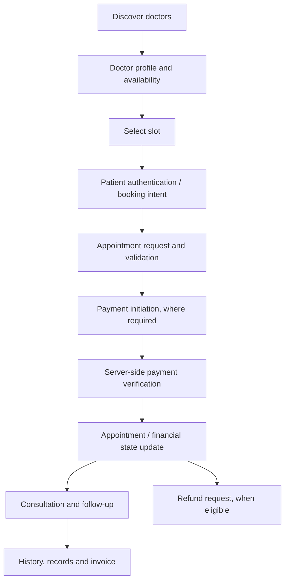
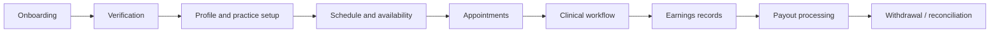
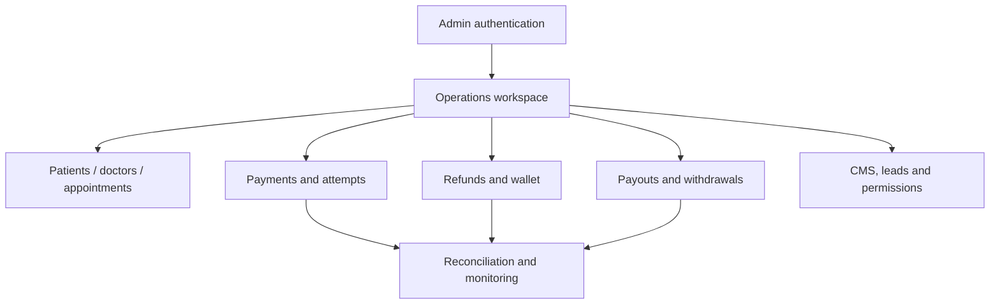
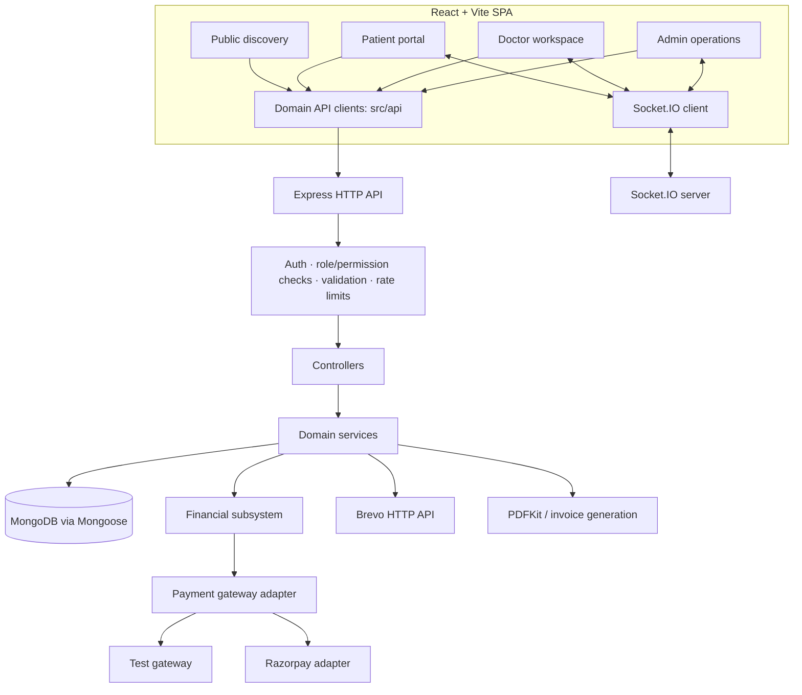
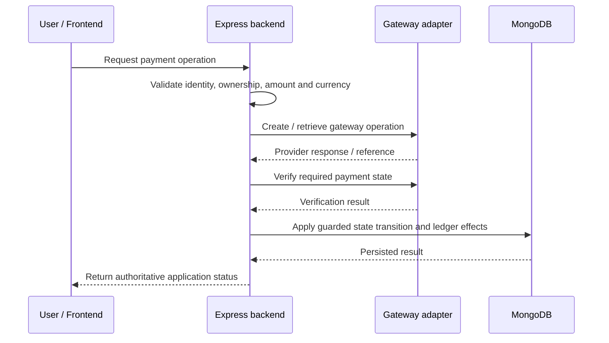

<div align="center">

<<<<<<< HEAD
# 🏥 MediCore HMS

### Healthcare operations, clinical workflows & financial integrity — in one full-stack platform

**A domain-oriented Hospital / Healthcare Management System built with React, Node.js, Express and MongoDB.**

[](https://react.dev/)
[](https://vite.dev/)
[](https://nodejs.org/)
[](https://expressjs.com/)
[](https://www.mongodb.com/)
[](https://socket.io/)
[](https://razorpay.com/)
[](license)
[](docs/PROJECT_STATUS.md)

**[Architecture](docs/ARCHITECTURE.md) · [Feature Map](docs/FEATURES.md) · [Project Status](docs/PROJECT_STATUS.md) · [Known Risks](docs/REMAINING_RISKS.md)**

</div>

---

> [!IMPORTANT]
> **Development project — not declared production-ready.** Feature code and automated tests do not equal live clinical, payment, security, or regulatory validation. Review [`docs/PROJECT_STATUS.md`](docs/PROJECT_STATUS.md) and [`docs/REMAINING_RISKS.md`](docs/REMAINING_RISKS.md) before deploying or using real patient/payment data.

## 📌 Project at a glance

MediCore HMS connects three operational experiences—**patients, doctors, and administrators**—with a dedicated financial domain for payments, wallet operations, refunds, payouts, withdrawals, invoices, and reconciliation.

The repository contains a React single-page application, a Node.js/Express API, MongoDB persistence through Mongoose, Socket.IO real-time infrastructure, transactional email through Brevo's HTTP API, PDF generation, and a gateway adapter that separates the in-repository test gateway from Razorpay integration.

The project is actively developed in phases. Its current documented engineering focus includes financial correctness, lifecycle/state transitions, duplicate-processing protection, API and role boundaries, and operational readiness.

### 🧭 Product areas

| Area | What the codebase covers | Status notes |
|---|---|---|
| 🌐 Public discovery | Doctor search and profiles, comparison, services, articles/CMS, coverage map, SEO, contact/leads | Feature code documented in [`FEATURES.md`](docs/FEATURES.md) |
| 🧑‍⚕️ Patient portal | Authentication, booking, appointment history, medical records, family members, invoices, wallet/refund flows | Payment and wallet verification is limited by the real-gateway test gap |
| 🩺 Doctor workspace | Onboarding/verification, profile, schedule, appointments, clinical workspace, reviews, earnings and payouts | See feature-by-feature status in [`FEATURES.md`](docs/FEATURES.md) |
| 🛡️ Admin operations | Doctor/patient/appointment operations, finance, permissions, CMS, leads, monitoring, audit logs, automation and governance | Some external integration scope has not been independently verified |
| 💳 Financial domain | Payments/attempts, wallet/recharges, refunds, payouts/withdrawals, invoices, ledger and reconciliation | Real Razorpay sandbox flow has not been live-verified in this environment |
| 🔔 Realtime | Socket.IO chat, presence and notifications | Presence/rate-limit state assumes a single backend instance |
| 🤖 AI-assisted features | Patient-facing assistant and admin insights | Real provider credentials/configuration required; not autonomous diagnosis |

> **Status vocabulary:** “Implemented” means the corresponding code and application wiring exist; it does **not** mean independent security audit, load testing, regulatory compliance, or production verification. Partial and verification-limited items are tracked in [`docs/FEATURES.md`](docs/FEATURES.md).

## 🧑‍🤝‍🧑 User journeys

### Patient journey



Booking, appointment state, and payment state are related but distinct. A browser callback alone is not proof that a payment succeeded; the backend must validate the relevant gateway and business state.

### Doctor journey



### Admin journey



## 🏗️ Architecture



The diagram is a high-level map of repository boundaries, not a runtime trace for every endpoint.

### Design choices

- **Domain-oriented backend:** routes, controllers, services, and models are grouped by product responsibility instead of treating the entire platform as a flat CRUD API.
- **Shared API layer:** frontend domain clients in `src/api/` provide a consistent boundary between UI and backend.
- **Server-side authorization:** UI route guards support navigation, while backend middleware is responsible for protecting operations and data.
- **Explicit financial lifecycle:** payment, recharge, refund, payout, and withdrawal operations have distinct records and state transitions.
- **Recovery and reconciliation:** pending, failed, cancelled, and completed states are not interchangeable; recovery paths and duplicate-processing controls are part of the financial design.
- **Operational traceability:** administrative activity, transaction history, and domain timelines provide records for supported workflows.

Read [`docs/ARCHITECTURE.md`](docs/ARCHITECTURE.md), [`docs/SYSTEM_DESIGN.md`](docs/SYSTEM_DESIGN.md), and [`docs/FINANCIAL_ARCHITECTURE.md`](docs/FINANCIAL_ARCHITECTURE.md) for the detailed design.

## 🧰 Technology stack

| Layer | Technologies evidenced in the repository |
|---|---|
| Frontend | React 19, Vite 8, JavaScript, React Router 7, Axios |
| Styling / interaction | Tailwind CSS 4 Vite plugin, Framer Motion, Lucide React |
| Geographic UI | Leaflet, React Leaflet |
| Realtime client/server | Socket.IO Client, Socket.IO |
| Backend | Node.js `>=22.12.0`, Express 5 |
| Persistence | MongoDB, Mongoose 9 |
| Authentication | JWT (`jsonwebtoken`), bcrypt |
| Security / HTTP | Helmet, CORS, express-rate-limit, compression |
| Financial integration | Razorpay SDK behind `backend/payments/paymentGateway.js`; in-repo test gateway |
| Email | Brevo transactional HTTP API (SMTP is not used by this configuration) |
| Documents / uploads | PDFKit, Multer |
| AI integration | `@google/genai` is present in backend dependencies; provider configuration and feature status are documented separately |
| Operations | Docker, Docker Compose, Nginx, CI workflow |
| Testing | Node.js test runner via `backend/tests/run-all.mjs`; Mongo-backed financial/integration test scripts |

Dependency versions and available scripts are defined by [`package.json`](package.json) and [`backend/package.json`](backend/package.json).

## 💳 Financial workflows and correctness

Financial operations are intentionally separated from ordinary appointment CRUD. The domain includes:

- Payments and payment attempts
- Wallet balances and wallet recharges
- Refund requests and refund processing
- Doctor payout records and withdrawal workflows
- Invoices and payment references
- Transaction ledger and reconciliation
- Webhook/event handling and duplicate-processing controls

### Payment lifecycle (simplified)



This sequence is conceptual; exact steps vary by operation and gateway mode.

### Financial safety principles

1. Never accept a frontend callback as the sole authority for payment success.
2. Validate amount, currency, ownership, and provider references on the server.
3. Prevent duplicate credits or repeated processing using the applicable idempotency and uniqueness controls.
4. Keep pending, failed, cancelled, refunded, and completed states distinct where the workflow defines them.
5. Treat refunds and payouts as separate stateful operations—not as a flag on the original appointment.
6. Reconcile internal records with trusted provider state where supported.

### Gateway modes and verification boundary

The adapter is `backend/payments/paymentGateway.js`. `PAYMENT_GATEWAY_MODE=test` selects the in-repository test gateway; Razorpay mode requires real credentials and webhook configuration. The test gateway exercises the application's test lifecycle, but **does not prove live Razorpay checkout, webhooks, settlement, or production credentials work**. The real Razorpay sandbox path remains a documented verification gap.

See [`docs/FINANCIAL_ARCHITECTURE.md`](docs/FINANCIAL_ARCHITECTURE.md) and [`docs/REMAINING_RISKS.md`](docs/REMAINING_RISKS.md).

## 🔐 Authentication, privacy and security

The repository includes JWT authentication, bcrypt password hashing, role/permission middleware, request-rate limiting, Helmet security headers, consent/privacy-related models and routes, and administrative audit records.

Relevant backend middleware includes:

- `backend/middleware/authMiddleware.js`
- `backend/middleware/roleMiddleware.js`
- `backend/middleware/adminMiddleware.js`

Security controls must be verified for each protected route and deployment. Their presence is not a certification of HIPAA, GDPR, India's DPDP Act, or any other regulatory compliance. Do not use real patient data until security, privacy, operational, and legal requirements have been independently assessed.

Report security issues according to [`SECURITY.md`](SECURITY.md). Never commit secrets, production database URLs, API keys, or real patient data.

## 🗂️ Repository layout

```text
MediCore-HMS/
├── backend/
│   ├── controllers/       # HTTP orchestration, grouped by domain and role
│   ├── models/            # Mongoose schemas and domain records
│   ├── routes/            # API route definitions
│   ├── services/          # Reusable business/domain services
│   ├── payments/          # Financial lifecycle, gateway adapter, reconciliation
│   ├── socket/            # Socket.IO auth, rooms, presence and events
│   ├── middleware/        # Auth, authorization, rate limits and error handling
│   ├── tests/             # Backend tests and custom test runner
│   ├── migrations/        # Data/schema migration and integrity utilities
│   ├── scripts/           # Preflight, release and runtime verification
│   ├── Dockerfile
│   └── package.json
├── src/
│   ├── pages/             # Public, auth, patient, doctor, admin and other views
│   ├── components/        # Reusable UI and domain components
│   ├── api/               # Frontend API modules
│   ├── context/            # Shared client state and auth context
│   ├── layout/             # Shared public/dashboard layouts
│   ├── socket/             # Socket.IO client and event contract
│   └── utils/              # Shared UI/business helpers
├── shared/                 # Cross-application shared code
├── docs/                   # Architecture, status, risks and operations docs
├── scripts/                # Root-level checks and production smoke script
├── .github/workflows/      # CI workflow
├── Dockerfile              # Frontend container build
├── backend/Dockerfile      # Backend container build
├── docker-compose.yml
├── nginx.conf
├── .env.example
├── package.json
├── README.md
├── SECURITY.md
├── CONTRIBUTING.md
└── license
```

## 🚀 Getting started

### Prerequisites

- **Node.js `>=22.12.0`** (declared by both package manifests)
- npm
- A local MongoDB instance or a reachable MongoDB deployment
- Git
- Optional integrations: Brevo credentials for transactional email, Razorpay credentials for real payment integration, and the configured AI provider credentials for AI-assisted features

### 1. Clone the repository

```bash
git clone https://github.com/vivektyagi05/MediCore-HMS.git
cd MediCore-HMS
```

### 2. Configure the frontend

```bash
npm install
```

Create `.env` from `.env.example`.

**Windows PowerShell**

```powershell
Copy-Item .env.example .env
```

**macOS / Linux**

```bash
cp .env.example .env
```

The root example currently includes these frontend values:
=======
MediCore HMS is a full-stack healthcare-management application for patient, doctor, and administrative workflows. The repository contains a React/Vite frontend, a Node.js/Express backend, MongoDB persistence through Mongoose, and supporting real-time and payment-related modules.

**Project status:** active development. The presence of code or documentation for a feature does not establish end-to-end correctness or production readiness. See [Project Status](docs/PROJECT_STATUS.md) and [Remaining Risks](docs/REMAINING_RISKS.md).

## Main areas

Feature documentation describes patient and doctor workflows, appointments, authentication and role-based access, clinical records, notifications, and financial workflows. Availability and verification depth vary by feature; consult [Feature Map](docs/FEATURES.md) rather than treating this list as a production guarantee.

Financial workflows have dedicated design documentation: [Financial Architecture](docs/FINANCIAL_ARCHITECTURE.md), [Accounting Contract](docs/FINANCIAL-ACCOUNTING-CONTRACT.md), and [Payment Business Logic](docs/PAYMENT-BUSINESS-LOGIC-SPEC.md).

## Technology

- **Frontend:** React, Vite, JavaScript, React Router, Axios, Tailwind CSS integration, Framer Motion, Socket.IO client.
- **Backend:** Node.js (repository `.nvmrc`: 22), Express, Mongoose, JWT-based authentication, Socket.IO.
- **Database:** MongoDB.
- **Integrations:** Razorpay payment gateway and Brevo transactional email are referenced by the repository configuration. Live integration behavior is not asserted here.

See the root and `backend` package manifests for the exact dependency declarations and scripts.

## Repository layout

```text
src/                  React frontend
backend/              Express API, domain modules, models, tests and migrations
shared/               Shared modules
docs/                 Current guides, architecture and historical reports
.github/workflows/    CI workflow definitions
docker-compose.yml    Local/container orchestration configuration
Dockerfile            Frontend/container build configuration
backend/Dockerfile     Backend container configuration
```

## Prerequisites

- Node.js compatible with the repository's `.nvmrc` (currently `22`).
- npm.
- A MongoDB instance for database-backed workflows.
- Credentials only for integrations you intend to exercise. Do not use production credentials for local development.

Docker is an alternative if you choose the repository's Compose setup. Container and deployment instructions must be verified in your own environment before relying on them.

## Local setup

Install the root and backend dependencies separately:

```bash
npm install
npm --prefix backend install
```

Create local environment files from the checked-in examples:

```bash
# Windows PowerShell
Copy-Item .env.example .env
Copy-Item backend/.env.example backend/.env

# macOS/Linux
cp .env.example .env
cp backend/.env.example backend/.env
```

Fill in the required values for your local environment. At minimum, configure the backend MongoDB connection and authentication secret. Never commit `.env` files or real credentials.

Start the frontend development server from the repository root:

```bash
npm run dev
```

Start the backend in a second terminal:

```bash
npm run dev:backend
```

The root environment example uses `VITE_API_BASE_URL` for the frontend API base URL. The backend environment example documents backend settings such as `MONGO_URI`, `JWT_SECRET`, `PORT`, `CORS_ORIGIN`, and `FRONTEND_URL`. Read the example files before running the application; not every integration variable is required for every workflow.

## Database and migrations

Use a MongoDB database dedicated to local development. Do not point development scripts or tests at production data. The backend package declares migration and integrity-audit scripts; review the relevant migration file and its documented prerequisites before running any migration. This README does not claim that migrations have been executed against a live database.

## Existing commands

Run commands from the repository root unless noted.

| Purpose | Command |
|---|---|
| Frontend development server | `npm run dev` |
| Backend development server | `npm run dev:backend` |
| Frontend build | `npm run build` |
| Lint | `npm run lint` |
| Backend test suite | `npm run test:backend` |
| Backend tests directly | `npm --prefix backend test` |
| Production smoke script | `npm run smoke:production` |

The backend also declares `npm --prefix backend test:mongo` for MongoDB integration tests. These tests require the environment described by their test files and are not equivalent to the ordinary backend test suite. Commands are listed from manifests; this documentation task did not run them.

## Documentation guide

- [Documentation index](docs/README.md)
- [Architecture](docs/ARCHITECTURE.md)
- [System design and request flow](docs/SYSTEM_DESIGN.md)
- [Feature map](docs/FEATURES.md)
- [Project status](docs/PROJECT_STATUS.md)
- [Remaining risks](docs/REMAINING_RISKS.md)
- [Deployment guide](docs/DEPLOYMENT_GUIDE.md)
- [Testing and release gates](docs/TESTING-AND-RELEASE-GATES.md)
- [Test matrix](docs/TEST_MATRIX.md)
- [Financial architecture](docs/FINANCIAL_ARCHITECTURE.md)
- [Documentation audit report](docs/audits/DOCUMENTATION_AUDIT_REPORT.md)

Historical phase notes, audit snapshots, and remediation reports are kept under `docs/history/`. They describe past work and must not be read as current verification without checking their date, commit, and environment.

## Deployment

The repository contains Docker and split-host deployment configuration. Follow [Deployment Guide](docs/DEPLOYMENT_GUIDE.md) and verify the setup in the intended environment. No deployment URL, successful live integration, compliance certification, or production-readiness claim is made here.

## Contributing and security

Read [CONTRIBUTING.md](CONTRIBUTING.md), [CODE_OF_CONDUCT.md](CODE_OF_CONDUCT.md), and [SECURITY.md](SECURITY.md). Report vulnerabilities privately rather than publishing exploit details in a public issue.
>>>>>>> 7b10e9b (Clean up and reorganize project documentation)

```dotenv
VITE_API_BASE_URL=http://localhost:5000/api
VITE_SITE_URL=http://localhost:5173
```

<<<<<<< HEAD
Vite environment values are compiled into the frontend build. Rebuild the frontend after changing production `VITE_*` values.

### 3. Configure the backend

Open a second terminal:

```bash
cd backend
npm install
```

Create `backend/.env` from `backend/.env.example` using the matching PowerShell or shell copy command above. Set at least the MongoDB connection string and a strong JWT secret for local development. Configure CORS, frontend URL, and integration credentials as needed.

Example local configuration keys:

```dotenv
NODE_ENV=development
PORT=5000
CORS_ORIGIN=http://localhost:5173
FRONTEND_URL=http://localhost:5173
MONGO_URI=mongodb://127.0.0.1:27017/hms_pro
JWT_SECRET=replace-with-a-long-random-development-secret
PAYMENT_GATEWAY_MODE=test
```

Use only values appropriate for a disposable local development database. Never use sample secrets or the test gateway in production. The backend's environment validation may require additional fields for production; see `backend/.env.example` and `docs/DEPLOYMENT_GUIDE.md`.

### 4. Start the backend

From `backend/`:

```bash
npm run dev
```

The configured development port is `5000`. Check the startup logs and current health-route configuration rather than assuming startup alone means the database and required indexes are ready.

### 5. Start the frontend

In a separate terminal from the repository root:

```bash
npm run dev
```

Vite's local development URL is typically `http://localhost:5173`.

### 6. Verify the local setup

- MongoDB connects to the intended development database.
- Backend starts without configuration or syntax errors.
- Frontend API requests use `VITE_API_BASE_URL` correctly.
- CORS matches the frontend origin.
- Registration, login, role access, and password recovery are checked in the local environment.
- Payment tests are run in test mode unless a dedicated Razorpay sandbox is configured.
- No real patient information or production credentials are used in development fixtures.

## ⚙️ Environment variables

Use the example files as the definitive source for the complete list; names and requiredness can evolve.

| Variable | Purpose |
|---|---|
| `VITE_API_BASE_URL` | Frontend API base URL (root `.env.example`) |
| `VITE_SITE_URL` | Public frontend URL used by frontend configuration |
| `MONGO_URI` | Backend MongoDB connection string |
| `JWT_SECRET` | JWT signing secret; production validation requires a strong value |
| `NODE_ENV` | Environment mode; use `production` on a production deployment |
| `PORT` | Backend HTTP port; example default is `5000` |
| `CORS_ORIGIN` | Allowed frontend origin(s) configured for the backend |
| `FRONTEND_URL` | Public frontend URL used by backend flows |
| `TRUST_PROXY` | Number of trusted reverse-proxy hops, configured for hosting topology |
| `PAYMENT_GATEWAY_MODE` | Gateway mode; test mode is for non-production testing only |
| `RAZORPAY_KEY_ID` | Razorpay key identifier |
| `RAZORPAY_KEY_SECRET` | Razorpay server-side secret |
| `RAZORPAY_WEBHOOK_SECRET` | Razorpay webhook verification secret |
| `BREVO_API_KEY` | Brevo transactional HTTP API credential |
| `BREVO_SENDER_EMAIL` / `BREVO_SENDER_NAME` | Transactional email sender identity |
| `SEO_SITE_URL` | Canonical public site URL used by SEO configuration |
| `OPENAI_API_KEY` / AI provider configuration | Required only for the corresponding configured AI provider/features; verify current provider settings |

> 🔒 Keep secrets in environment variables or the hosting platform's secret manager. Do not expose backend-only secrets through `VITE_*` variables; Vite values are public to the browser.

## 🧪 Tests, lint and build

### Commands defined by the repository

From the repository root:

```bash
npm run lint
npm run build
npm run test:backend
npm run smoke:production
```

From `backend/`, the backend manifest defines:

```bash
npm test
npm run test:mongo
npm run preflight
npm run release
```

Use `npm run` and `npm --prefix backend run` to inspect the scripts in the checked-out version. MongoDB-backed tests require the relevant dependencies and test database configuration.

### Documented verification snapshot

The checked-in [`docs/PROJECT_STATUS.md`](docs/PROJECT_STATUS.md) records this verification snapshot for the documented code state:

| Check | Documented result | Interpretation |
|---|---|---|
| Frontend build | **Pass** | Build completed, with bundle-size warnings noted in the status/risk docs |
| Lint | **Not clean** | 7 pre-existing errors documented |
| Backend test suite | **90 passed / 4 failed (94 total)** | Four known failures documented: three test-runner path-resolution issues and one export-name mismatch |
| Live Razorpay sandbox | **Not verified** | Real gateway checkout/webhook lifecycle remains an open gap |
| Live Docker Compose | **Not verified** | A live Docker daemon was unavailable during the documented verification |
| Production runtime / load test | **Not verified** | No production readiness claim is made |

These are **repository-documented results, not a live test run performed by this README**. Re-run the checks on the current commit before making a release decision. For the exact known gaps and their context, see [`docs/REMAINING_RISKS.md`](docs/REMAINING_RISKS.md).

### Financial concurrency tests

The backend defines `test:mongo` for Mongo-backed financial/concurrency suites. Use a dedicated disposable test database and review the test files before execution. Test-mode success does not establish that live payment settlement, webhook delivery, or production infrastructure is correct.

## 🐳 Deployment

The repository supports two documented deployment shapes:

1. **Split hosting:** static frontend on a static host, Node backend as a separate service, and MongoDB as a managed database.
2. **Docker Compose:** frontend served by Nginx, backend API, MongoDB, and a dedicated worker service, with a release/preflight step.

### Docker Compose quick start

After configuring `backend/.env` with appropriate local/demo values and ensuring Docker Engine is installed:

```bash
docker compose build
docker compose up -d
docker compose ps
```

Documented local endpoints:

- Frontend: `http://localhost:8080`
- Backend: `http://localhost:5000`
- MongoDB: internal Compose network; not published to the host by default

The Compose configuration includes a one-shot release step and a separate worker for scheduled financial tasks. Check health status and logs for all services. The repository's documented risk status says this Compose stack has **not yet been verified against a live Docker daemon in the recorded environment**; run it and validate the services before relying on it.

### Production deployment checklist

- [ ] Review `docs/PROJECT_STATUS.md` and close launch-blocking risks.
- [ ] Use a managed, backed-up MongoDB deployment with encryption-at-rest appropriate to the data.
- [ ] Set `NODE_ENV=production` and all required production environment variables.
- [ ] Generate a strong JWT secret and configure trusted proxy hops accurately.
- [ ] Configure the real frontend origin, CORS, HTTPS, and canonical site URL.
- [ ] Configure and test Brevo delivery if email/OTP is required.
- [ ] Validate Razorpay sandbox checkout, signature/webhook handling, refunds, and reconciliation end to end before any live use.
- [ ] Back up both MongoDB data **and uploaded files**; the documented uploaded-file backup process is not yet automated.
- [ ] Review worker/scheduler deployment so the intended worker topology is preserved.
- [ ] Run tests, lint, build, production smoke checks, and a live staging walkthrough.
- [ ] Complete independent security review and appropriate privacy/legal assessment.
- [ ] Review logs and alerting without recording secrets or unnecessary clinical data.

See [`docs/DEPLOYMENT_GUIDE.md`](docs/DEPLOYMENT_GUIDE.md) for the full deployment procedure.

## ⚠️ Known limitations and launch blockers

The maintained risk register is [`docs/REMAINING_RISKS.md`](docs/REMAINING_RISKS.md). Its documented high-priority items include:

- Vite and React Router dependency advisories that need a dedicated major-version upgrade and regression pass.
- Real Razorpay sandbox checkout/webhook/payment lifecycle not yet verified in the documented environment.
- Docker Compose and full runtime behavior not verified against live infrastructure in that environment.
- Uploaded invoices, prescriptions, reports, and insurance files do not yet have automated scheduled backups.
- Realtime presence and some rate-limit counters are in-process memory and assume a single backend instance; horizontal scaling needs shared infrastructure/adapters.
- No independent security audit, SAST/DAST or git-history secret scan is recorded.
- Performance findings are based on code review, not measured production profiling or load tests.
- The frontend bundle has documented size warnings.

This list is a summary, not a substitute for the risk register. Risk status may change as code and deployment evolve.

## 📚 Documentation map

| Document | Use it for |
|---|---|
| [`docs/README.md`](docs/README.md) | Documentation index and phase history |
| [`docs/ARCHITECTURE.md`](docs/ARCHITECTURE.md) | Architecture boundaries and domain map |
| [`docs/SYSTEM_DESIGN.md`](docs/SYSTEM_DESIGN.md) | Request and data flow |
| [`docs/FINANCIAL_ARCHITECTURE.md`](docs/FINANCIAL_ARCHITECTURE.md) | Payment, wallet, refund, payout and reconciliation design |
| [`docs/FEATURES.md`](docs/FEATURES.md) | Feature-by-feature status |
| [`docs/PROJECT_STATUS.md`](docs/PROJECT_STATUS.md) | Current status and verification snapshot |
| [`docs/REMAINING_RISKS.md`](docs/REMAINING_RISKS.md) | Known gaps and launch risks |
| [`docs/DEPLOYMENT_GUIDE.md`](docs/DEPLOYMENT_GUIDE.md) | Docker, split hosting, environment and backups |
| [`docs/FINAL-END-TO-END-CLOSURE-REPORT.md`](docs/FINAL-END-TO-END-CLOSURE-REPORT.md) | Evidence report for end-to-end closure work |
| [`SECURITY.md`](SECURITY.md) | Security issue reporting and security notes |
| [`CONTRIBUTING.md`](CONTRIBUTING.md) | Contribution and review workflow |
| [`CHANGELOG.md`](CHANGELOG.md) | Phase history and recorded changes |

## 🤝 Contributing

1. Read the relevant architecture and feature-status documents.
2. Identify the domain boundary and existing behavior before changing code.
3. Add or update tests for the changed contract and failure paths.
4. Run the applicable checks and report any environment-dependent blockers honestly.
5. Update documentation when feature status, environment requirements, or operational behavior changes.
6. Review `git diff` and ensure no secrets, production data, or generated artifacts are included.

Changes to payments, wallet, refunds, payouts, or withdrawals need extra review for state transitions, idempotency, concurrency, recovery, and reconciliation. Follow the financial review checklist in [`CONTRIBUTING.md`](CONTRIBUTING.md).

## 📄 License

MediCore HMS is distributed under the MIT License. See [`license`](license) for the license text.

---

<div align="center">

**Built for learning and engineering practice around real-world healthcare workflows.** 🏥🔐💳

[⬆ Back to top](#-medicore-hms)

</div>
=======
The repository includes the MIT license in [`license`](license). Preserve its copyright and license text when redistributing the project.
>>>>>>> 7b10e9b (Clean up and reorganize project documentation)
