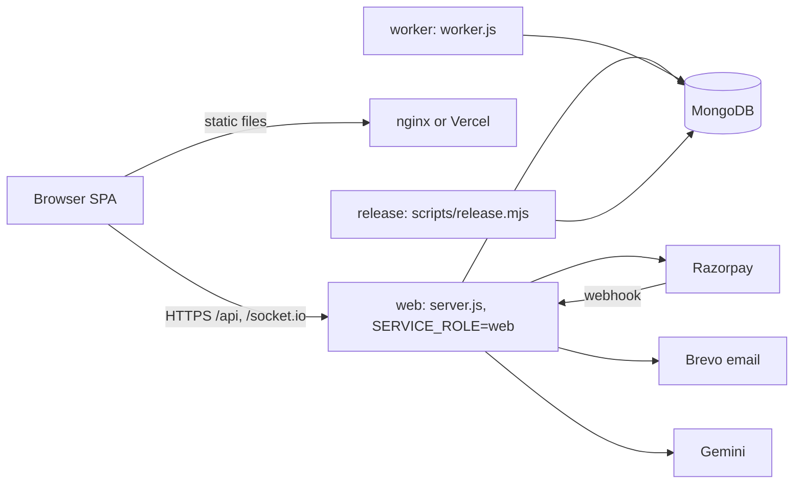

# Architecture

> **Status: rewritten from the code in the audited snapshot.** Nothing was executed. Deep dives: [system design](architecture/system-design.md) · [database](architecture/database-design.md) · [auth](architecture/authentication-authorization.md) · [payments](architecture/payments-financial-architecture.md) · [realtime](architecture/realtime-architecture.md) · [scheduler](SCHEDULER-ARCHITECTURE.md) · [AI](AI-ARCHITECTURE.md).

## Overview
MediCore HMS is a React single-page application (Vite) talking to a Node.js/Express API backed by MongoDB (Mongoose), with Socket.IO for realtime events.

The release job runs before web/worker on each deploy; the worker runs the in-process scheduler; only web serves HTTP and sockets.

## Repository layout
| Path | Contents |
|---|---|
| `src/` | Frontend: `pages/` (public, patient, doctor, admin, auth, ai, chat, dashboard, finance, invoice, payment), `components/`, `api/`, `context/`, `layout/`, `routes/` (`AppRoutes.jsx`, `PrivateRoute.jsx`), `socket/`, `i18n/` |
| `backend/` | `app.js`, `server.js`, `worker.js`; `routes/`, `controllers/`, `services/`, `models/`, `middleware/`, `payments/`, `socket/`, `cron/`, `automation/`, `ai/`, `migrations/`, `master-data/`, `scripts/`, `tests/` |
| `shared/` | Code shared by frontend and backend |
| `scripts/` | Repository-level scripts (smoke test, validators) |
| `docs/` | Documentation ([index](README.md)) |

## Request path
Page → API client (`src/api/`) → Express route → middleware (auth → role/permission → rate limit) → controller → service / `payments/` → Mongoose model → MongoDB. Roles: `super_admin`, `doctor`, `patient` (no separate `admin`).

## Components
- **Authentication:** Bearer JWT with `securityVersion`; see [auth](architecture/authentication-authorization.md).
- **Payments:** gateway adapter (`backend/payments/paymentGateway.js`) with Razorpay (required in production) or an in-repo test gateway; webhook handled in `app.js` before the JSON parser; see [payments](architecture/payments-financial-architecture.md).
- **Realtime:** Socket.IO with per-process presence; see [realtime](architecture/realtime-architecture.md).
- **Scheduling:** worker with seven in-process jobs plus CLI-launchable jobs; see [scheduler](SCHEDULER-ARCHITECTURE.md).
- **AI:** provider abstraction with Gemini or template output; see [AI](AI-ARCHITECTURE.md).
- **Email:** Brevo via an outbox (`emailOutboxService.js`, `EmailDelivery` model).
- **Storage:** `local` or `s3` (`STORAGE_DRIVER`).
- **Data:** 56 Mongoose models; see [database design](architecture/database-design.md). Migrations are numbered scripts in `backend/migrations/`; the release job runs 005, 012 and 011.

## Limitations
Single-instance realtime/rate limiting, AI free-text privacy, and unverified live integrations: see [Remaining risks](REMAINING_RISKS.md).
